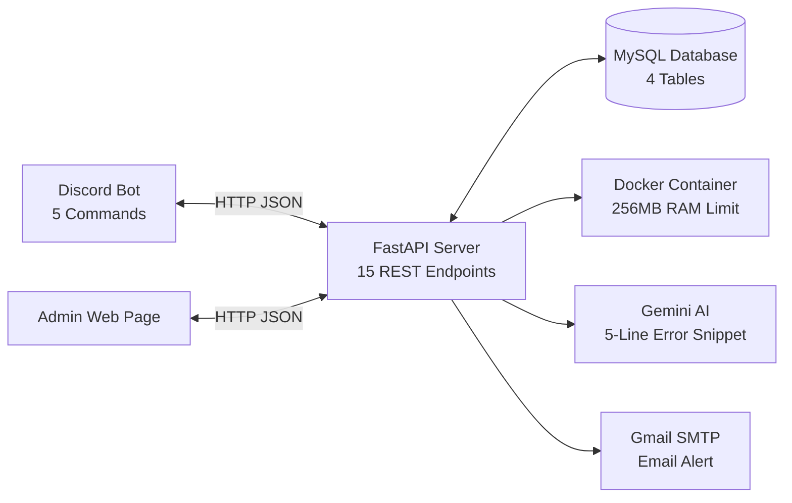
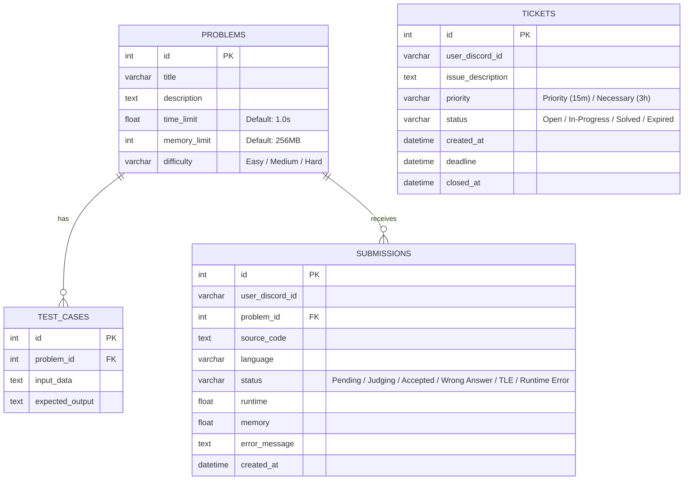

# Discord Online Judge & IT Ticket System

A web and Discord application that lets users view coding problems, submit Python code to be tested automatically inside Docker containers, get AI explanations for code errors, and submit IT support tickets with a live countdown timer.

---

## System Flow



---

## Database Schema (ER Diagram)

- **`problems` (1) $\rightarrow$ (N) `test_cases`**: One coding problem has multiple test cases (`problem_id` Foreign Key).
- **`problems` (1) $\rightarrow$ (N) `submissions`**: One coding problem receives multiple user code submissions (`problem_id` Foreign Key).
- **`tickets`**: Standalone table storing IT support issues reported by Discord users with countdown deadlines.



---

## Main Features (With Exact Specs)

1. **Docker Code Sandbox (`app/workers/sandbox_worker.py`):**
   - Runs user-submitted Python code inside an isolated `python:3.12-alpine` Docker container.
   - Enforces a `256MB` RAM limit, disables internet access (`network_disabled=True`), mounts files as read-only, and stops infinite loops using a `1.0s - 2.0s` execution timeout (`TLE`).

2. **AI Error Helper (`app/services/ai_service.py`):**
   - Reads the Python error traceback to find the exact line number that crashed.
   - Cuts AI code input by **80%–90% on 25–50 line submissions** by extracting only a **5-line code snippet** (`2 lines before`, `the error line`, and `2 lines after`) to send to the `gemini-3.5-flash-lite` model instead of sending the whole file.
   - For `Wrong Answer` submissions, attaches the failed Test Case `Input`, `Your Output`, and `Expected Output` so the AI can explain the logic mistake.

3. **IT Support Tickets with Countdown & Email (`app/api/endpoints/tickets.py`):**
   - Users report issues from Discord using interactive buttons with **2 priority levels**:
     - **Priority (System / API):** `15-minute` countdown timer.
     - **Necessary (Problem / Code):** `3-hour` countdown timer.
   - The Admin web page updates the countdown every `1 second` and automatically changes the ticket status from `Open` / `In-Progress` to `Expired` when time runs out.
   - Automatically sends an email alert to the Admin via Gmail SMTP (`port 465`) when a new ticket is created.

4. **Database & API (`app/models/`, `app/api/endpoints/`):**
   - **4 MySQL tables:** `problems`, `test_cases`, `submissions`, and `tickets`.
   - **15 REST API endpoints** built with FastAPI and SQLAlchemy.

---

## Discord Bot Commands

This bot was created to provide an easy way to code directly on Discord without needing a PC or Mac. Users can write code directly on Discord and get results anywhere. Below is the syntax for using this bot:

- `*problems` : Show all problems.
- `*problem <id>` : View problem details (e.g., `*problem 1`).
- `*submit <id> <code>` : Submit your Python code for a problem.
- `*explain <submission_id>` : Ask AI to explain and fix your code error.
- `*ticket <description>` : Report a system or problem issue to the Admin.

---

## Tech Stack

- **Backend:** Python 3.12, FastAPI, SQLAlchemy, Pydantic
- **Database:** MySQL
- **Code Runner:** Docker (`python:3.12-alpine`)
- **Frontend & Bot:** `discord.py`, HTML, Tailwind CSS, Alpine.js
- **External Services:** Google Gemini API, Python `smtplib` (Gmail)

---

## How to Run

1. **Install dependencies:**
   ```bash
   python3 -m venv venv
   source venv/bin/activate
   pip install -r requirements.txt
   ```

2. **Set up `.env`:**
   ```bash
   cp .env.example .env
   ```

3. **Download Docker image:**
   ```bash
   docker pull python:3.12-alpine
   ```

4. **Start FastAPI Server:**
   ```bash
   uvicorn main:app --reload
   ```
   Admin page: `http://127.0.0.1:8000/admin`

5. **Start Discord Bot:**
   ```bash
   python bot.py
   ```
