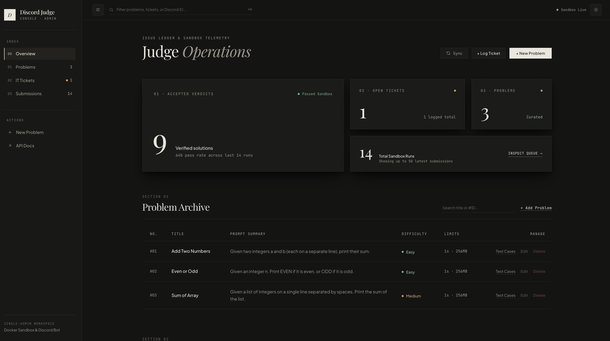
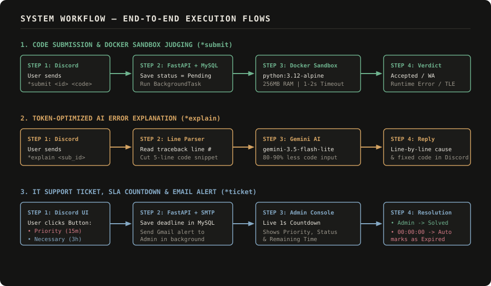
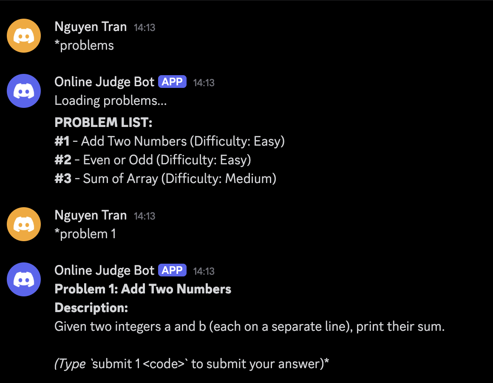
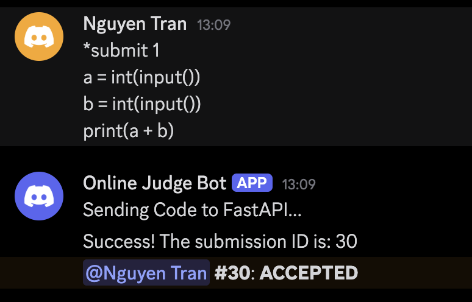
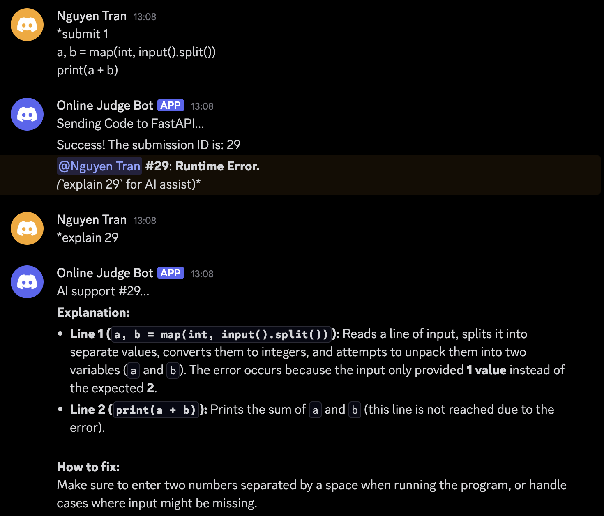
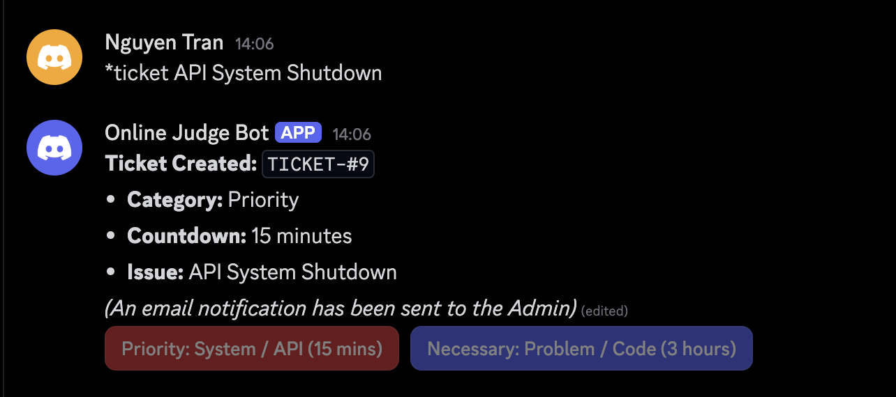
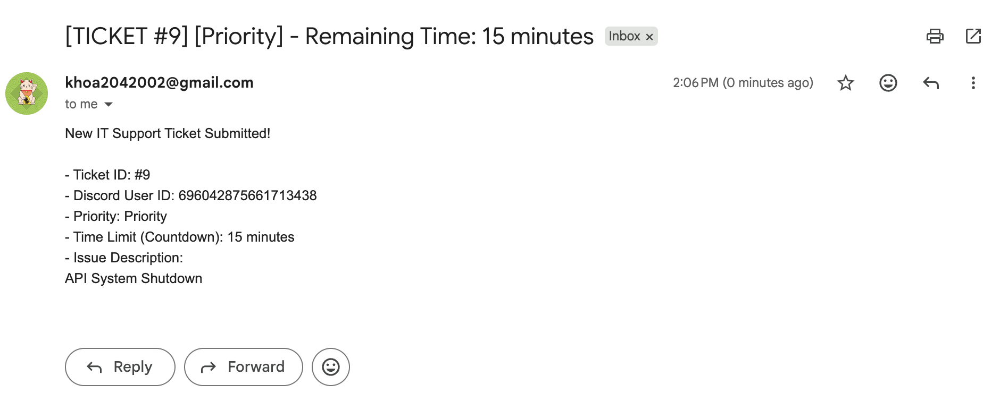

# Discode and Ticket

I built this project so users can write and test Python code directly on Discord without needing a PC or Mac. When a user submits code on Discord, my FastAPI server runs it inside an isolated Docker container and returns the result right in the chat. If the code crashes or fails a test case, users can ask AI to explain the error. I also built an IT Ticket system with a live countdown timer and Gmail alerts so I can track and fix system or problem issues from an Admin web page.

---

## System Workflow & Live Screenshots

### 1. Browse Problems, Submit Code & Docker Judging
1. Browse Problems: User views all problems with \*problems and checks problem details with \*problem [id].
2. Submit: User sends Python code on Discord using \*submit [problem_id] [your_code].
3. Queue: FastAPI saves the submission into MySQL with status Pending and starts a background task.
4. Sandbox Run: The worker runs the code against each Test Case inside an isolated python:3.12-alpine Docker container (256MB RAM limit, no internet, read-only files, 1.0s - 2.0s timeout).
5. Result: The status updates to Accepted, Wrong Answer, Runtime Error, or TLE (Time Limit Exceeded) and the bot tags the user on Discord with the result.

Viewing Problem List & Details:

Submitting Solution:

---

### 2. AI Error Explanation
1. Request: User types \*explain [submission_id] after a failed submission.
2. Slice Error Lines: FastAPI reads the saved error traceback, finds the exact error line number, and extracts only 5 lines of code (2 lines above, the error line, and 2 lines below), cutting code input by 80%–90% on 25–50 line submissions.
3. AI Response: Gemini explains the cause of the error in English and replies on Discord with how to fix it.

---

### 3. IT Ticket, SLA Countdown & Email Alert
1. Classify: User types \*ticket [description] and clicks one of 2 buttons on Discord:
   - Priority (System / API): Sets a 15-minute countdown deadline.
   - Necessary (Problem / Code): Sets a 3-hour countdown deadline.
2. Email Alert: FastAPI saves the ticket to MySQL and sends an email notification to the Admin via Gmail SMTP (port 465).
3. Track & Expire: The Admin web page counts down every 1 second. If the timer reaches 00:00:00 before being handled, the status automatically changes to Expired; once fixed, the Admin marks it as Solved.

Discord Ticket Creation:

Automated Admin Email Alert:

---

## Database ERD (Entity-Relationship Diagram)

- problems (1 to N) test_cases: One coding problem has many test cases (test_cases.problem_id references problems.id).
- problems (1 to N) submissions: One coding problem receives many code submissions (submissions.problem_id references problems.id).
- tickets: Independent table storing IT support issues submitted from Discord with countdown deadlines (15 minutes for Priority, 3 hours for Necessary).

---

## Main Features

1. Docker Code Sandbox (app/workers/sandbox_worker.py)
   - Runs user-submitted Python code inside an isolated python:3.12-alpine Docker container.
   - Enforces a 256MB RAM limit, disables internet access (network_disabled=True), mounts files as read-only, and stops infinite loops using a 1.0s - 2.0s execution timeout (TLE).

2. AI Error Helper (app/services/ai_service.py)
   - Reads the Python error traceback to find the exact line number that crashed.
   - Cuts AI code input by 80%–90% on 25–50 line submissions by extracting a 5-line code snippet (2 lines before, the error line, and 2 lines after) to send to the gemini-3.5-flash-lite model instead of sending the whole file.
   - For Wrong Answer submissions, attaches the failed Test Case Input, Your Output, and Expected Output so the AI can explain the logic mistake.

3. IT Support Tickets with Countdown & Email (app/api/endpoints/tickets.py)
   - Users report issues from Discord using interactive buttons with 2 priority levels:
     - Priority (System / API): 15-minute countdown timer.
     - Necessary (Problem / Code): 3-hour countdown timer.
   - The Admin web page updates the countdown every 1 second and automatically changes the ticket status from Open / In-Progress to Expired when time runs out.
   - Automatically sends an email alert to the Admin via Gmail SMTP (port 465) when a new ticket is created.

4. Database & API (app/models/, app/api/endpoints/)
   - 4 MySQL tables: problems, test_cases, submissions, and tickets.
   - 15 REST API endpoints built with FastAPI and SQLAlchemy.

---

## Discord Bot Commands

This bot was created to provide an easy way to code directly on Discord without needing a PC or Mac. Users can write code directly on Discord and get results anywhere. Below is the syntax for using this bot:

- \*problems : Show all problems.
- \*problem [id] : View problem details (e.g., \*problem 1).
- \*submit [id] [code] : Submit your Python code for a problem.
- \*explain [submission_id] : Ask AI to explain and fix your code error.
- \*ticket [description] : Report a system or problem issue to the Admin.

---

## Tech Stack

- Backend: Python 3.12, FastAPI, SQLAlchemy, Pydantic
- Database: MySQL
- Code Runner: Docker (python:3.12-alpine)
- Frontend & Bot: discord.py, HTML, Tailwind CSS, Alpine.js
- External Services: Google Gemini API, Python smtplib (Gmail)

---

## How to Run

1. Install dependencies:
   python3 -m venv venv
   source venv/bin/activate
   pip install -r requirements.txt

2. Set up .env:
   cp .env.example .env

3. Download Docker image:
   docker pull python:3.12-alpine

4. Start FastAPI Server:
   uvicorn main:app --reload
   Admin page: http://127.0.0.1:8000/admin

5. Start Discord Bot:
   python bot.py
